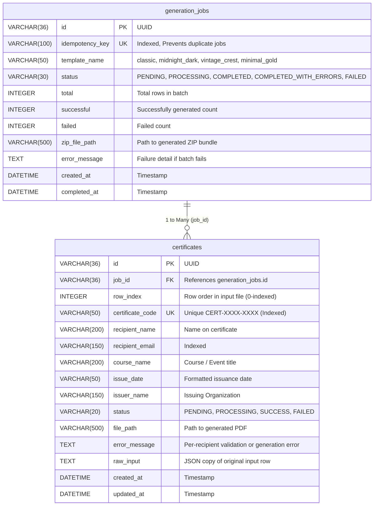

# Bulk Certificate Generator API & Service

A robust, production-grade backend service built with **Python 3.12+**, **FastAPI**, **ReportLab**, and **SQLite/SQLAlchemy** for asynchronously generating, validating, distributing, and verifying bulk credentials and certificates in vector PDF format.

Includes a single-page management console with live telemetry, embedded Swagger & ReDoc OpenAPI documentation, background batch processing, and unique collision-resistant verification codes with scannable QR codes.

---

## 🏛 Architecture Overview

```
                  ┌───────────────────────────────┐
                  │   Client / Web UI / CSV / API │
                  └───────────────┬───────────────┘
                                  │
                                  ▼
                    ┌───────────────────────────┐
                    │     FastAPI Endpoints     │
                    │   (/api/certificates/...) │
                    └─────────────┬─────────────┘
                                  │
                                  ▼
                   ┌─────────────────────────────┐
                   │    Row Validation Loop      │
                   │ (Valid -> PENDING           │
                   │  Invalid -> FAILED record)  │
                   └──────────────┬──────────────┘
                                  │
                                  ▼
                   ┌─────────────────────────────┐
                   │    Job Initialized in DB    │
                   │     (Status: PENDING)       │
                   └──────────────┬──────────────┘
                                  │
                     (FastAPI BackgroundTasks)
                                  │
                                  ▼
                   ┌─────────────────────────────┐
                   │     Job Processor Worker    │
                   │    (Status: PROCESSING)     │
                   └──────────────┬──────────────┘
                                  │
                                  ▼
                   ┌─────────────────────────────┐
                   │    Certificate Generator    │
                   │  (ReportLab Multi-Template) │
                   └──────────────┬──────────────┘
                                  │
                  ┌───────────────┴───────────────┐
                  ▼                               ▼
     ┌────────────────────────┐      ┌─────────────────────────┐
     │  Vector PDF Documents  │      │ Bundled ZIP Archive     │
     │ (generated/{job_id}/*.pdf) │  │(generated/{job_id}/*.zip)│
     └────────────┬───────────┘      └────────────┬────────────┘
                  │                               │
                  └───────────────┬───────────────┘
                                  │
                                  ▼
                   ┌─────────────────────────────┐
                   │  Status: COMPLETED / ERRORS │
                   │   (Stored in SQLite WAL)    │
                   └──────────────┬──────────────┘
                                  │
                                  ▼
                   ┌─────────────────────────────┐
                   │  Status Polling, Download   │
                   │   and Public Verification   │
                   └─────────────────────────────┘
```

---

## 🛠 Technology Stack

| Layer | Technology | Rationale |
| :--- | :--- | :--- |
| **Backend Framework** | **FastAPI** | High-throughput asynchronous routing, native dependency injection, and automatic OpenAPI schema generation. |
| **Language** | **Python 3.12+** | Robust standard library, static typing annotations, and broad ecosystem. |
| **Data Validation** | **Pydantic v2 & pydantic-settings** | Strict typing, fast schema parsing, and centralized configuration settings. |
| **Database & ORM** | **SQLite + SQLAlchemy 2.0** | Zero-configuration persistence with Write-Ahead Logging (`WAL`) mode and foreign keys enabled for concurrent read/write throughput. |
| **PDF Generation** | **ReportLab 4.1+** | Native vector rendering, lightweight execution, sub-second compilation with zero browser/Node.js dependencies. |
| **QR Code Engine** | **qrcode[pil]** | Real-time generation of high-contrast verification QR codes embedded directly into PDF headers. |
| **Async Processing** | **FastAPI BackgroundTasks** | Lightweight in-process background worker execution with zero Redis/Celery infrastructure overhead. |
| **Testing** | **Pytest** | Test suite with isolated SQLite database and temporary directory fixtures. |

---

## 🎨 Supported Certificate Templates

The engine includes 4 pre-configured, print-ready vector templates:

1. **`classic` (Royal Navy & Gold — Default)**:
   - Tech Institute signature design with sharp angled navy polygons and metallic gold trim stripes.
   - Top-centered Greek pillar crest, live verification QR code, italic calligraphic recipient name, and center gold medallion seal with double signature lines.
2. **`midnight_dark` (Midnight Luxury Dark)**:
   - Deep navy-black background with luminous gold typography, gold foil corner highlights, and high-contrast dark-mode QR code.
3. **`vintage_crest` (Vintage Crest Parchment)**:
   - Warm ivory parchment background with ornamental vintage guilloche borders, traditional academic typography, and gold insignia seal.
4. **`minimal_gold` (Minimalist Modern Gold)**:
   - Crisp modern aesthetic with refined hairline gold accents, modern typography, and clean layout.

---

## 📁 Repository Structure

```
bulk-certificate-generator/
│
├── backend/
│   ├── app/
│   │   ├── __init__.py
│   │   ├── config.py                   # Centralized Pydantic BaseSettings configuration
│   │   ├── main.py                     # FastAPI application setup, CORS, lifespan & StaticFiles mount
│   │   ├── database.py                 # SQLite WAL mode setup, session factory, get_db dependency
│   │   ├── models.py                   # SQLAlchemy models (GenerationJob, CertificateRecord)
│   │   ├── schemas.py                  # Pydantic schemas with row-level validation support
│   │   │
│   │   ├── routers/
│   │   │   ├── __init__.py
│   │   │   └── certificates.py         # REST endpoints (generate, upload, status, download, verify)
│   │   │
│   │   ├── services/
│   │   │   ├── __init__.py
│   │   │   ├── certificate_generator.py # ReportLab PDF canvas vector engine & multi-template generator
│   │   │   └── job_processor.py        # Background worker, batched DB commits, recovery & ZIP bundler
│   │   │
│   │   └── utils/
│   │       ├── __init__.py
│   │       ├── file_parser.py          # CSV, TSV, JSON, XLSX ingestion & auto-header recognition
│   │       └── validators.py           # Email, name, course, and date validation helpers
│   │
│   ├── generated/                      # Target storage for job folders, PDFs, and ZIP bundles
│   ├── templates/                      # Static reference PDF template
│   │
│   ├── tests/
│   │   ├── __init__.py
│   │   ├── conftest.py                 # Test client, isolated SQLite database, and tmp_path fixtures
│   │   ├── test_jobs.py                # Job creation, validation failure isolation, progress & idempotency
│   │   ├── test_validation.py          # Data validation & Pydantic constraints
│   │   ├── test_generation.py          # ReportLab PDF creation, scaling, accented characters
│   │   ├── test_retrieval.py           # PDF download, ZIP bundle download, and verification
│   │   └── test_file_parser.py         # CSV, TSV, JSON, XLSX file ingestion tests
│   │
│   └── requirements.txt                # Backend dependencies
│
├── frontend/                           # Single-page console (HTML5, CSS3, ES6 JavaScript)
│   ├── index.html
│   ├── styles.css
│   └── app.js
│
├── requirements.txt                    # Project root dependencies
├── .gitignore
└── README.md
```

---

## 🗄 Database Structure



---

## 🚀 Setup and Run Steps

### 1. Prerequisites
- **Python 3.12+** installed
- `pip` package manager

### 2. Create and Activate Virtual Environment
```bash
# On Windows (PowerShell)
python -m venv venv
.\venv\Scripts\Activate.ps1

# On Linux / macOS
python3 -m venv venv
source venv/bin/activate
```

### 3. Install Dependencies
```bash
pip install -r requirements.txt
```

### 4. Run the API Server
Run Uvicorn from the `backend` directory:

```bash
cd backend
python -m uvicorn app.main:app --reload --port 8000
```

The API and static console will be available at:
- **Interactive UI Dashboard**: `http://127.0.0.1:8000/` (or `http://localhost:3000` when running frontend separately)
- **Health Check**: `http://127.0.0.1:8000/health`
- **Interactive Swagger Documentation**: `http://127.0.0.1:8000/docs`
- **ReDoc Documentation**: `http://127.0.0.1:8000/redoc`

---

## 🧪 How to Run the Tests

Execute the complete test suite from the `backend` directory:

```bash
cd backend
python -m pytest -v
```

The test suite validates 6 core functional areas:
1. **Creating a Job**: Validates submitting jobs via JSON and file uploads.
2. **Validation**: Email formats, name constraints, date normalization, and row-level validation isolation (invalid rows recorded as `FAILED` without failing the batch).
3. **Generation**: ReportLab PDF canvas compilation, font scaling, accented Latin characters (NFC), and vector star drawings.
4. **Progress Tracking**: Progress percentages, completed/total counts, and state transitions.
5. **Individual Certificate Failure Isolation**: Simulates single-certificate failure and verifies the batch completes with `COMPLETED_WITH_ERRORS`.
6. **Retrieval**: Downloading single certificate PDFs, downloading ZIP archives, and authenticating codes against the public verification endpoint.

---

## 📡 API Reference & cURL Examples

### 1. Submit a Bulk Generation Job (JSON)
One bad recipient row will **not** block the batch with a 422 error; valid rows become `PENDING` and invalid rows become `FAILED`.

```bash
curl -X POST http://127.0.0.1:8000/api/certificates/generate \
  -H "Content-Type: application/json" \
  -d '{
    "template_name": "classic",
    "issuer_name": "TECH INSTITUTE",
    "idempotency_key": "batch-2025-q2-001",
    "deduplicate_by_email": true,
    "recipients": [
      {
        "recipient_name": "Carol White",
        "recipient_email": "carol.white@techinstitute.edu",
        "course_name": "Data Structures & Algorithms",
        "issue_date": "10 April 2025"
      },
      {
        "recipient_name": "Marcus Aurelius Reed",
        "recipient_email": "marcus.reed@domain.com",
        "course_name": "Advanced Distributed Systems",
        "issue_date": "10 April 2025"
      }
    ]
  }'
```

**Response (`202 Accepted`):**
```json
{
  "id": "3b29c9fe-1763-4416-b8cb-4f40f287e07a",
  "idempotency_key": "batch-2025-q2-001",
  "template_name": "classic",
  "status": "PENDING",
  "total": 2,
  "completed": 0,
  "successful": 0,
  "failed": 0,
  "progress_percentage": 0.0,
  "recommended_polling_interval_seconds": 2,
  "download_zip_url": null,
  "error_message": null,
  "created_at": "2025-04-10T10:00:00Z",
  "completed_at": null
}
```

---

### 2. Submit Bulk Generation Job (File Upload)
Upload roster files in **Excel (.xlsx, .xls)**, **CSV (.csv)**, **TSV (.tsv)**, or **JSON (.json)**:

```bash
curl -X POST http://127.0.0.1:8000/api/certificates/upload-file \
  -F "file=@recipients.xlsx" \
  -F "issuer_name=TECH INSTITUTE" \
  -F "template_name=classic" \
  -F "deduplicate=true"
```

---

### 3. Check Job Status & Counts
Poll job progress, summary metrics, and generated records:

```bash
curl http://127.0.0.1:8000/api/certificates/jobs/3b29c9fe-1763-4416-b8cb-4f40f287e07a
```

**Response (`200 OK`):**
```json
{
  "id": "3b29c9fe-1763-4416-b8cb-4f40f287e07a",
  "idempotency_key": "batch-2025-q2-001",
  "template_name": "classic",
  "status": "COMPLETED",
  "total": 2,
  "completed": 2,
  "successful": 2,
  "failed": 0,
  "progress_percentage": 100.0,
  "recommended_polling_interval_seconds": 2,
  "download_zip_url": "/api/certificates/jobs/3b29c9fe-1763-4416-b8cb-4f40f287e07a/download-zip",
  "error_message": null,
  "created_at": "2025-04-10T10:00:00Z",
  "completed_at": "2025-04-10T10:00:02Z",
  "certificates": [
    {
      "id": "a901ff2a-8c90-482d-8a12-1f38e217d84a",
      "job_id": "3b29c9fe-1763-4416-b8cb-4f40f287e07a",
      "row_index": 0,
      "certificate_code": "CERT-6D26-BB86",
      "recipient_name": "Carol White",
      "recipient_email": "carol.white@techinstitute.edu",
      "course_name": "Data Structures & Algorithms",
      "issue_date": "10 April 2025",
      "issuer_name": "TECH INSTITUTE",
      "status": "SUCCESS",
      "download_url": "/api/certificates/a901ff2a-8c90-482d-8a12-1f38e217d84a/download",
      "error_message": null,
      "created_at": "2025-04-10T10:00:01Z"
    }
  ]
}
```

---

### 4. Download Single Certificate PDF
```bash
curl -O http://127.0.0.1:8000/api/certificates/a901ff2a-8c90-482d-8a12-1f38e217d84a/download
```

---

### 5. Download Bundled ZIP Archive
```bash
curl -O http://127.0.0.1:8000/api/certificates/jobs/3b29c9fe-1763-4416-b8cb-4f40f287e07a/download-zip
```

---

### 6. Verify Certificate Authenticity
```bash
curl http://127.0.0.1:8000/api/certificates/verify/CERT-6D26-BB86
```

**Response (`200 OK`):**
```json
{
  "is_valid": true,
  "certificate_code": "CERT-6D26-BB86",
  "recipient_name": "Carol White",
  "course_name": "Data Structures & Algorithms",
  "issuer_name": "TECH INSTITUTE",
  "issue_date": "10 April 2025",
  "verification_timestamp": "2025-04-10T10:05:00Z",
  "download_url": "/api/certificates/a901ff2a-8c90-482d-8a12-1f38e217d84a/download",
  "error_message": null
}
```

---

## 💡 Design Decisions & Trade-offs

### 1. Why FastAPI `BackgroundTasks`?
- **Rationale**: Keeps the architecture lightweight and self-contained. The client receives an immediate `202 Accepted` response while certificate generation happens in the background without needing Redis, RabbitMQ, or Celery workers.
- **Trade-off**: `BackgroundTasks` execute in-process. If the server restarts mid-batch, in-memory execution halts.
- **Mitigation**: Statuses are persisted transactionally in SQLite (`PENDING`, `PROCESSING`, `SUCCESS`, `FAILED`). On server startup, `resume_interrupted_jobs()` runs automatically in a non-blocking background thread, discovering any unfinished jobs and resuming them from their last uncompleted certificate.

### 2. Why ReportLab?
- **Rationale**: ReportLab compiles PDF canvas primitives in pure Python. It is fast (generating a certificate in ~20 milliseconds) and produces resolution-independent vector graphics with compact file sizes (~15-30 KB per certificate).
- **Trade-off**: Requires explicit canvas layout positioning and font management.
- **Mitigation**: We use Unicode NFC normalization for Latin-1 accented characters (preserving names like *José* or *Müller*), dynamic font scaling to prevent long name overflows, and vector star polygons.

### 3. Per-Recipient Failure Isolation
- **Ingestion Isolation**: Instead of a strict top-level schema rejecting an entire 1,000-row batch if one row is invalid, each recipient is validated in an individual loop. Invalid rows become persistent `FAILED` records with descriptive error messages and row indices, while valid rows proceed to generation.
- **Generation Isolation**: During rendering, each certificate is wrapped in an individual `try/except` block. If PDF compilation fails for one recipient, that certificate is marked `FAILED` with the error captured, and the worker immediately proceeds to the next recipient. The job completes with `COMPLETED_WITH_ERRORS`.

### 4. Batched Database Commits & SQLite WAL Concurrency
- Processing large batches with individual commits creates thousands of transactions and locks SQLite.
- The worker batches database commits every 25 certificates and at job finalization.
- SQLite is configured with Write-Ahead Logging (`PRAGMA journal_mode=WAL`) and foreign keys enabled, allowing concurrent API reads while the worker writes.
